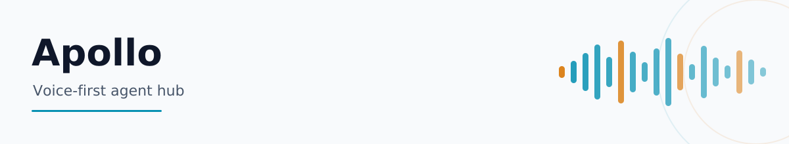
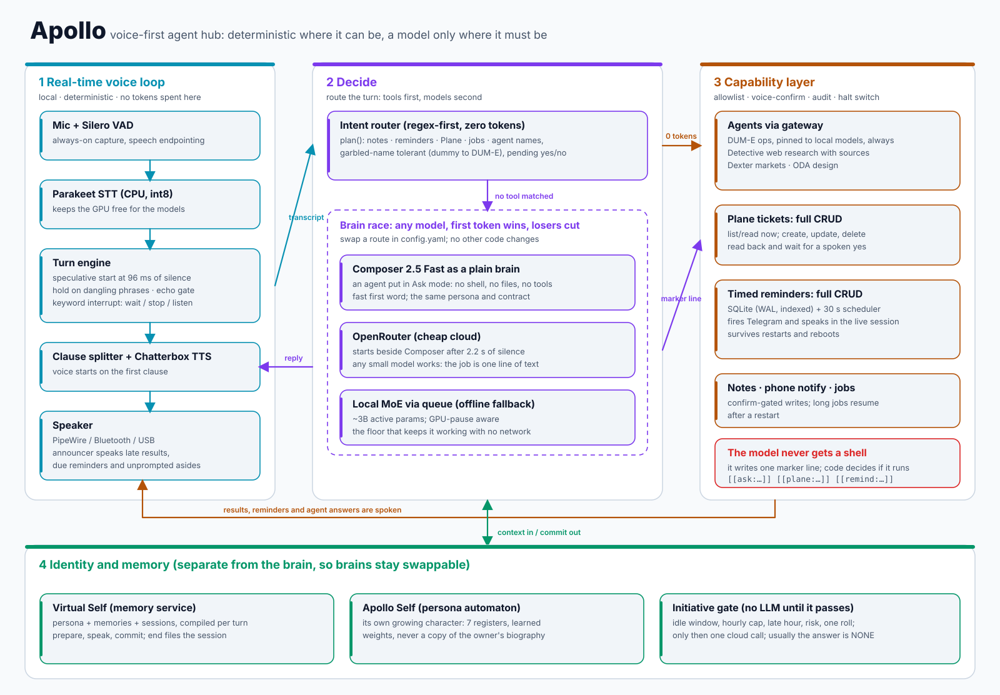

<div align="center">

<picture>
  <source media="(prefers-color-scheme: dark)" srcset="docs/readme/header-dark.svg">
  
</picture>

[](https://www.python.org/)
[](orchestrator)
[](LICENSE)
[](https://pipewire.org/)

<picture>
  <source media="(prefers-color-scheme: dark)" srcset="docs/readme/divider-dark.svg">
  
</picture>

</div>

Apollo is the voice interface I wanted for my own machine: one place to ask a question, manage a ticket, set a reminder, or hand work to another agent. Reminders can arrive on the phone and be spoken in the room. Longer jobs can finish in the background and report back when they are ready.

The main design rule is simple: use normal code wherever normal code is enough. Audio handling, routing, confirmations, memory and tool access do not need to be improvised by a language model. Models are kept behind a small text contract, which makes them replaceable and limits what they are allowed to do.

<div align="center">

<picture>
  <source media="(prefers-color-scheme: dark)" srcset="docs/architecture-dark.svg">
  
</picture>

</div>

## Memory that compounds

Apollo is designed to run with [**Virtual Self Memory**](https://github.com/Vector26/virtual-self-memory), a local-first learning and analytics layer for personal agents. This is what turns Apollo from a voice interface into a system that can build continuity over months and years.

- **Temporal memory** keeps authored, observed, valid and ingestion time separate, so Apollo can reason about when something happened instead of treating memory as a flat transcript.
- **OLAP-style learning** normalises archive events into partitioned Parquet and queries them with DuckDB across time, products, domains, places and contacts.
- **Hybrid recall** combines PostgreSQL full-text search with pgvector similarity to compile context for each turn.
- **Provenance** links learned memories and personality changes back to their source evidence.
- **Model independence** keeps memory outside the brain. Change the model and the accumulated self remains.

The connection point is deliberately small: Virtual Self Memory serves its local API on `127.0.0.1:8090`, while Apollo keeps the voice-session lifecycle in `vself_brain.py`. Context is prepared before a reply, only spoken turns are committed, and completed sessions are handed back for consolidation.

**[Explore Virtual Self Memory →](https://github.com/Vector26/virtual-self-memory)**

## What makes it different

Apollo is unusual less for any single component than for how the components are separated. Speech remains responsive, tools remain constrained, and the language model can be changed without rebuilding the assistant around it. I have not found another open project with this same combination, though most of the individual ideas have prior art.

| | |
|---|---|
| **The brain is a role, not the product** | An agent, a cloud model and a local model can answer in parallel. The first useful stream wins and the others are stopped. A route can be replaced in `config.yaml` without changing the rest of Apollo. |
| **Models do not control the machine** | A model may emit a marker such as `[[plane:list\|]]`. Apollo parses it, checks the allowlist and asks for spoken confirmation when needed. The model receives no shell, file access or general-purpose tool interface. |
| **Routing is deterministic first** | Common requests such as reminders, tickets and agent dispatch are recognised by code before a model is considered. The planner also handles predictable speech-to-text errors. |
| **Identity is separate from inference** | Persona and memory are assembled by a separate service for each turn. Changing the model does not reset the assistant's identity. |
| **Initiative has a gate** | Before Apollo speaks without being asked, ordinary code checks the idle period, time of day, hourly limit and risk. Most checks end without making a model call. |
| **The voice loop is its own system** | It includes endpoint holding, speculative starts, echo filtering, keyword interruption, reconnecting audio devices and per-turn latency measurements. |

## Agent-agnostic by construction

Every major part has a narrow contract. There is no required model vendor, and the agent gateway follows the same approach.

| Role | Contract | Current implementation | Configuration |
|---|---|---|---|
| Brain | text in, text stream out, optional marker line | Composer 2.5 Fast in Ask mode, OpenRouter, a local MoE behind a queue | `brains:` in `config.yaml` |
| Speech in | audio in, text out | Parakeet on CPU (Whisper supported) | `stt.engine` |
| Speech out | text in, audio out, per clause | Chatterbox Turbo, optional voice conversion | `tts:` and `orchestrator/voice/presets.yaml` |
| Tools | one allowlisted operation per marker | agent gateway, Plane, reminders, notes, phone notification | handler in `agent_tools.py` |
| Memory | `prepare`, `commit`, `end` over HTTP | [Virtual Self Memory](https://github.com/Vector26/virtual-self-memory) | any service with those three calls |

This works in both directions. Apollo can call different agents through the gateway, and an agent can also serve as Apollo's brain. The boundary is text, not a vendor-specific tool protocol.

## Why it is inexpensive

Apollo keeps the model's responsibilites small. This makes smaller models practical and avoids paying for work that deterministic code can already do.

- Voice activity detection, speech recognition and speech generation run locally. Parakeet runs on the CPU, leaving the GPU available for voice generation.
- Routing, confirmation, reminder scheduling, ticket operations and agent dispatch use no model tokens.
- Replies are short and the tool vocabulary is deliberately small, so a compact model can do the job.
- Memory is prepared outside the model. The brain receives the context needed for the current turn rather than a large history dump.
- The initiative gate rejects most opportunities to speak before any model is called.
- The fast agent route is optional. A low-cost cloud model or the local queue can run the same interface.

On my machine, Parakeet on CPU was about 20 times faster than Whisper on CPU at similar accuracy. That result is machine-specific and is recorded in [`CHANGELOG.md`](CHANGELOG.md). I have not published a dollar-per-hour comparison, so I do not make a cost claim beyond the design choices visible in the code.

## Safety model

- Tools are allowlisted functions rather than a sandbox around an unrestricted shell.
- Actions with meaningful side effects require spoken confirmation.
- The operations agent is restricted to local models, with a test covering that policy.
- Tool side effects are audited, and a global halt switch disables execution.
- Secrets are loaded from environment variables or key files, never from the repository.

## Repository map

```
orchestrator/
  cli.py                 live loop: capture, turns, barge-in, playback, announcer
  audio_io.py            VAD capture and playback        stt_stream.py   STT workers
  tts_engine.py          clause-level TTS                echo_gate.py    drop its own voice
  endpoint_hold.py       don't answer half a sentence    voice_interrupt.py  stop words
  vself_brain.py         brain race, marker peeling, memory calls
  cursor_brain.py        an agent session used as a plain brain
  agent_tools.py         planner, allowlist, confirmations, audit
  plane_client.py        ticket CRUD                     reminder_client.py  reminder CRUD
  initiative.py          when to speak unprompted        persona_automaton.py  growing temperament
  apollo_self.py         the assistant's own persona     announce.py     late results
  config.example.yaml    every knob, with comments
scripts/                 apollo, talk, speak, audio diagnostics
docs/                    ARCHITECTURE.md, REMINDER_API.md, measurements
```

## Quick start

```bash
git clone https://github.com/Vector26/apollo.git && cd apollo
python3 -m venv orchestrator/.venv && source orchestrator/.venv/bin/activate
pip install -r orchestrator/requirements.txt
cp orchestrator/config.example.yaml orchestrator/config.yaml   # then edit
scripts/apollo talk
```

`config.example.yaml` is the map for audio devices, model routes and integrations. Add your model assets, choose a voice, connect the services you want, and start talking.

For persistent learning and OLAP analytics, pair Apollo with [Virtual Self Memory](https://github.com/Vector26/virtual-self-memory). The integration point is `brains.vself.api_url`; both projects use port `8090` by default.

## Development

The core test suite runs without audio hardware or network access:

```bash
cd orchestrator && python -m unittest discover
```

For the full system design, start with [`docs/ARCHITECTURE.md`](docs/ARCHITECTURE.md). The reminder service contract is documented in [`docs/REMINDER_API.md`](docs/REMINDER_API.md).

## License

MIT. See [`LICENSE`](LICENSE).
