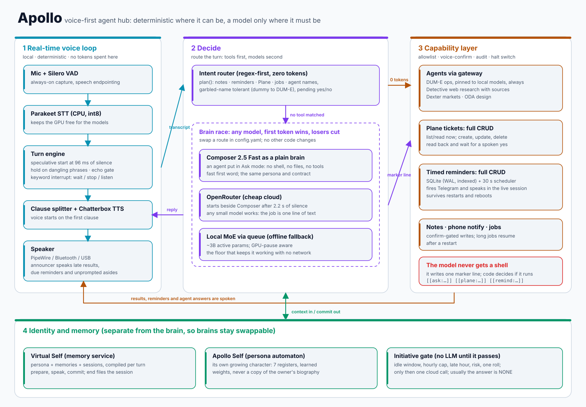

# Apollo architecture

Apollo is organised around one rule: **deterministic code does everything that can be done deterministically, and a model is asked only for language.** This document follows one spoken turn through the system, then explains each part, the safety model, the cost model, and how to extend it.

<picture>
  <source media="(prefers-color-scheme: dark)" srcset="architecture-dark.svg">
  
</picture>

## 1. Life of a turn

1. **Capture.** `audio_io.py` records the mic at 48 kHz, resamples to 16 kHz and runs Silero VAD (`vad_threshold`). Speech needs at least `min_speech_ms` to count.
2. **Speculative start.** After only `speculate_ms: 96` of silence the pipeline starts speech-to-text, the brain and the voice on a *guess* that you are done. The audio is not released until `silence_ms: 200` confirms it. If you keep talking, the speculative turn is cancelled and the words are carried into the next one (`carry.py`).
3. **Is it a whole thought?** `endpoint_hold.py` holds an utterance ending on a dangling word ("and", "the", "I just") for up to `hold_fragment_ms` so Apollo does not answer half a sentence. `echo_gate.py` drops a transcript that is mostly the assistant's own last sentence coming back through an open speaker.
4. **Transcribe.** `stt_stream.py`: Parakeet TDT 0.6B v3 through `onnx-asr`, int8 on CPU. Whisper through `faster-whisper` is the alternative (`stt.engine`).
5. **Route.** `AgentTools.plan()` in `agent_tools.py` tries to understand the sentence with rules, no model: notes, reminders, Plane, jobs, named agents, and a pending "yes or no". It tolerates mis-hearings through an alias table. A hit produces a `Plan` that is executed, or read back for confirmation first. **A hit costs zero tokens.**
6. **Think (only if no tool matched).** `vself_brain.py` asks the memory service to `prepare` the turn (persona, memories, session context), then runs the **brain race**:
   - Composer 2.5 Fast starts first, in Ask mode, over one long-lived `cursor-agent acp` process (`cursor_brain.py`). Ask mode means it cannot edit files or run commands.
   - If it has said nothing after `hedge_after_s: 2.2`, a cheap cloud model (OpenRouter) starts beside it, and the local model behind the queue is the last resort.
   - The **first token wins**; the other streams are closed. A route that fails before any token falls through to the next one.
7. **Peel markers.** If the model wrote a line like `[[remind:in|10m|stand up]]`, the stream filter removes it from the spoken text and hands it to the tool layer. Nothing else the model writes can cause an action.
8. **Speak.** The reply is split into clauses and voiced as soon as the first clause exists (`tts_engine.py`, Chatterbox Turbo, optional voice conversion). `speaker.py` keeps a Bluetooth stream warm so the first syllable is not lost. While it talks, a small keyword spotter (`voice_interrupt.py`) listens for *wait, stop, listen, hold on, pause* and similar, stops playback and returns to listening without needing open-mic barge-in.
9. **Commit.** The exchange is written back to the memory service (`commit`); a quiet conversation is filed with `end` after `idle_end_s`.

Between turns, `announce.py` speaks results that arrive late (a slow agent) and due reminders, but only when you are not mid-conversation, and `initiative.py` decides whether an unprompted remark is worth a model call.

## 2. The brain is a role

`vself_brain.py` treats each route as "something that yields text tokens". Composer, OpenRouter and the local model implement the same tiny interface, so adding a route is configuration (`brains:` in `config.yaml`) plus, at most, a small adapter. The persona and rules are sent by the memory service, not baked into a model, so the same character answers whichever route wins. The brain contract is deliberately small:

- text in, a stream of text out;
- optionally, one marker line from a documented menu;
- no tools, no files, no side effects.

That is why very small models are viable: "be brief, in character, and emit one line when asked" is a low bar.

## 3. Capability layer

`agent_tools.py` is the only code that can cause an effect.

| Tool | Marker | Notes |
|---|---|---|
| Agents | `[[ask:agent\|question]]` | via a gateway; agents are named in a registry; the ops agent is pinned to local models |
| Plane tickets | `[[plane:list\|]]`, `get`, `create`, `update`, `delete` | create/update/delete are read back and need a spoken yes |
| Reminders | `[[remind:...]]` | create (in / at / daily / weekly), list, update, delete; see [`REMINDER_API.md`](REMINDER_API.md) |
| Notes | planner only | create, append (confirmed), delete to a trash folder |
| Phone notify | planner only | confirmed before sending |
| Jobs | planner only | long agent jobs; confirmed first and remembered on disk so they resume after a restart |

Guarantees enforced in code and tests:

- **Allowlist.** Marker lines are parsed by code, and only the known verbs are dispatched (agents are limited to `CALLABLE_AGENTS`).
- **Confirmation.** A pending action is held in the session; only an explicit yes (`CONFIRM_YES`) runs it, and anything else drops it. Which tools are confirmed is configurable (`tools.confirm`).
- **Audit and halt.** Every side effect is logged. A halt flag (`halt.py`, written by an external switch) stops tool execution.
- **Local-only agent.** `DumeStaysLocalTest` checks that `agent_tools.py` contains no reference to a cloud brain, and (when a registry file is present) that the ops agent's endpoints are loopback addresses and it uses the local model. The registry half is skipped on a clean checkout.

## 4. Identity and memory

- **Virtual Self** is an external service with three calls (`prepare`, `commit`, `end`). It owns durable memory about the owner and compiles it into a per-turn context.
- **Apollo Self** (`apollo_self.py`, `persona_automaton.py`) is the assistant's *own* temperament: a small weighted automaton with seven registers whose weights shift with experience, saved to a state file. It never copies the owner's biography.
- **Initiative** (`initiative.py`) is a non-LLM gate: owner idle between `min_idle_s` and `max_idle_s`, at most `max_per_hour` remarks, a minimum gap, one weighted roll per quiet spell raised by late hour, long session or risk. Only if it passes is one cloud call made, and the answer is usually "NONE".

Because memory and persona sit outside the brain, you can change the model without changing who Apollo is.

## 5. Why it is cheap, in terms of the code

| Mechanism | Where |
|---|---|
| speech in and out are local, no per-minute API | `stt_stream.py`, `tts_engine.py`, `audio_io.py` |
| routing, confirmation and tool dispatch use no tokens | `agent_tools.py` |
| replies capped (`max_words: 140`, `max_tokens: 160 to 200`) | `brains.vself.cursor`, `brains.openrouter` |
| cheap models are first-class routes | `brains.openrouter`, `brains.vself.local` |
| session rotation keeps context short (`rotate_turns: 24`) | `cursor_brain.py` |
| nothing is generated while idle unless the gate opens | `initiative.py` |
| DNS cache so cold lookups do not add latency to each call | `dns_cache.py` |

No dollar figures are claimed. The point is that each turn's paid work is small and bounded, and that most of what Apollo does is not paid work at all.

## 6. Failure behaviour

- Cloud down: the local brain answers; a route that fails before a token falls through.
- Memory service down: `prepare_timeout_s` bounds the wait and the brain "uses last persona without memories" (the log wording).
- Reminder service down: the tool says it cannot reach it; talking is unaffected.
- Audio device unplugged or Bluetooth late at boot: `audio_devices.py` waits for PipeWire and the preferred device, falls back, and watches for the preferred one to return (`device_watch`).
- A marker line is held back from speech wherever it appears in the stream, so it is never read aloud.

## 7. Extending it

- **New tool.** Add a planner rule and an `apply()` in `agent_tools.py`, decide whether it needs confirmation, document its marker line in the model prompt, add tests next to `test_agent_tools.py`.
- **New brain route.** Add an entry under `brains:`; to make it race, add it to the hedge list.
- **New voice.** Add a profile in `orchestrator/voice/presets.yaml` with a reference clip you have the right to use.
- **Different memory service.** Implement `prepare`, `commit` and `end` and point `api_url` at it.

## 8. Layout and tests

`orchestrator/` holds the code and its tests (`test_*.py`, 465 passing, 2 skipped on a clean checkout). The tests use fakes for audio, the agent process (`fake_acp_server.py`) and the network, so they need no hardware. `scripts/` has launchers and audio diagnostics. `docs/research/` has measurements from the machine this was developed on.
